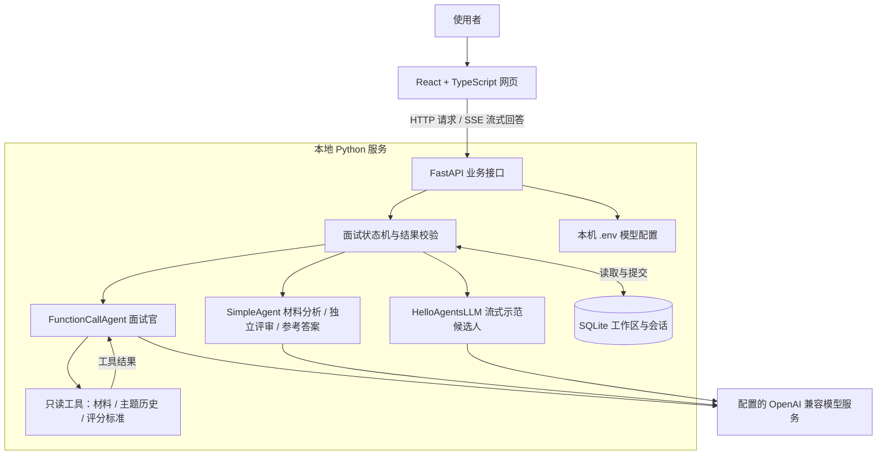
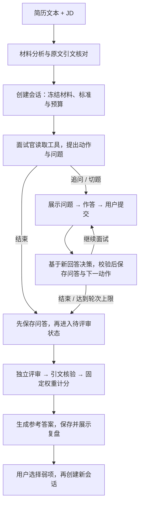
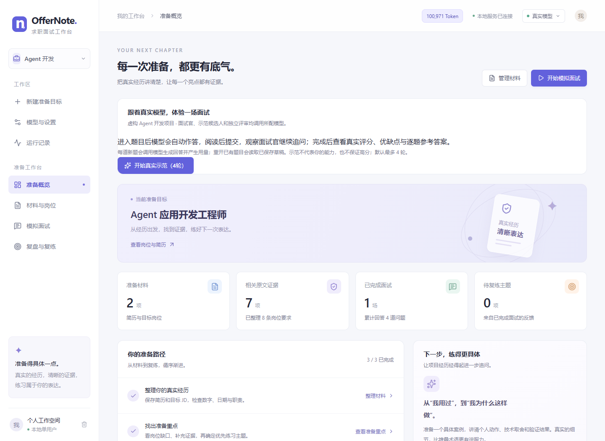
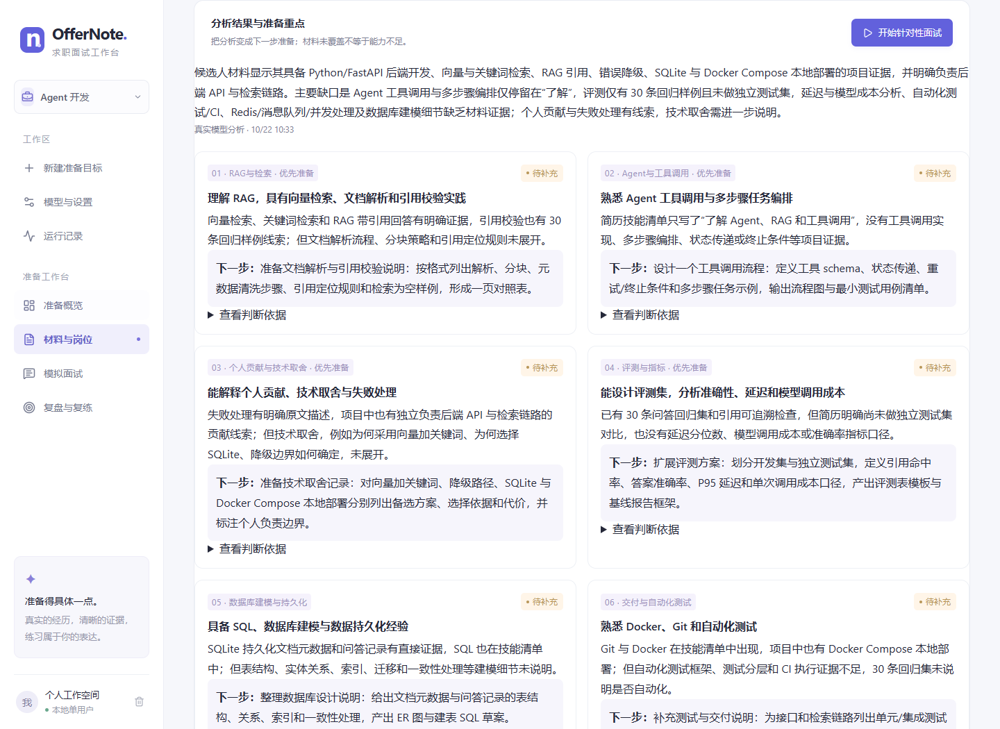
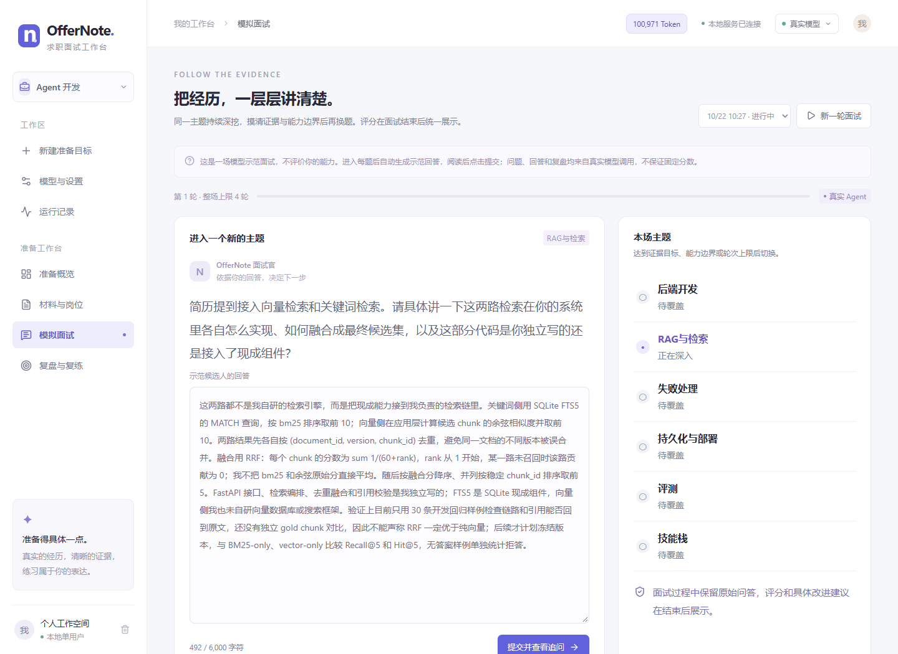
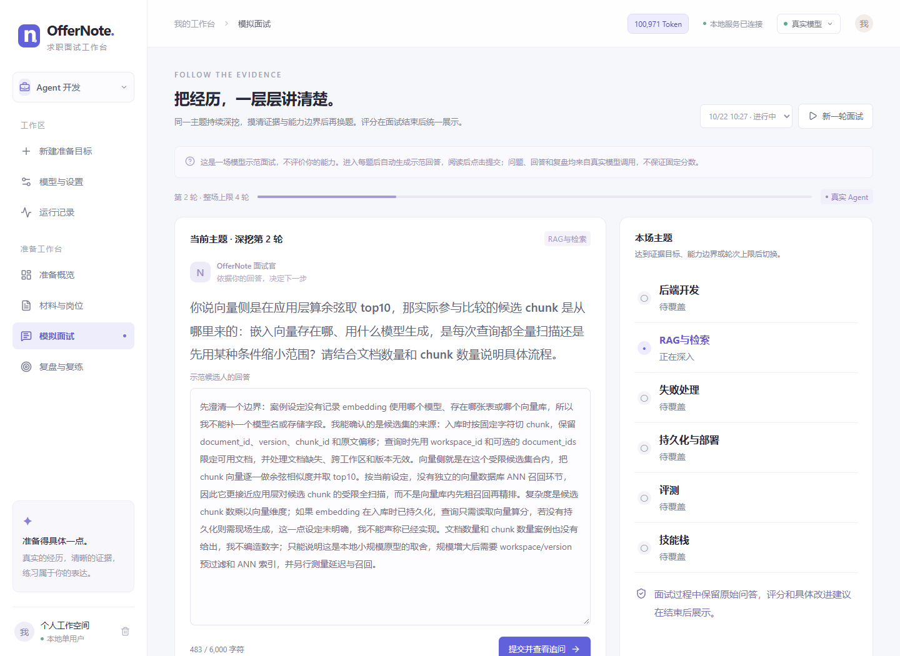
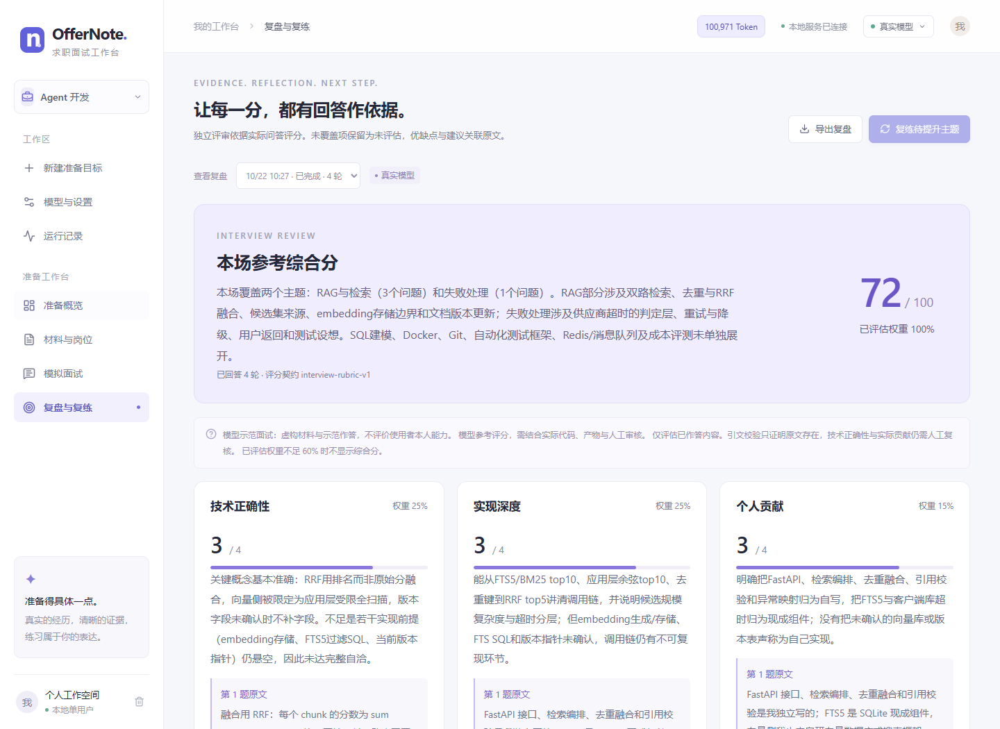
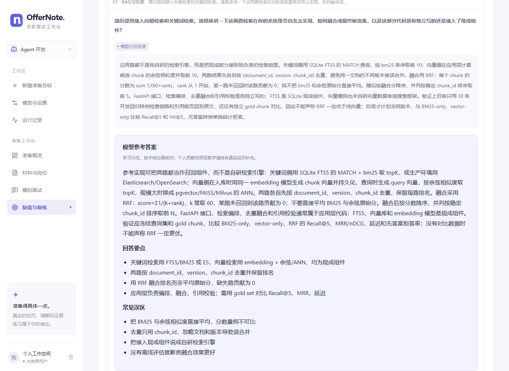

# OfferNote · 求职面试工作台

Hello-Agents 共创项目，一个本地单用户的通用面试准备工具。使用者可围绕自己的目标岗位，导入简历与 JD，完成材料分析、模拟面试和复盘复练。内置 Agent 开发案例用于演示使用流程；演示材料完全虚构，不包含真实简历、联系方式或个人贡献记录。

## 项目简介

真实模式通过 HelloAgents `FunctionCallAgent` 读取材料与问答历史，决定继续追问、切换主题或结束面试；独立评审生成六维评分、优缺点与练习建议，随后逐题生成参考答案。程序负责证据核验、状态持久化、预算和失败恢复。

## 核心功能

- 一个固定演示工作区：**Agent 开发**。真实模型担任面试官与示范候选人，再独立评审；个人工作区单独分组。
- 导入文字版 PDF、DOCX、Markdown、TXT 简历，录入 JD；在“材料与岗位”查看准备缺口、补充证据和优先练习主题。
- 同一主题连续深挖，根据回答切换主题；面试中不泄露参考答案或评分。
- 面后独立评分、回答引用、改进计划、逐题参考答案与 Markdown 导出。
- 页面保存模型配置到本机 `.env`，测试连接及原生工具调用；密钥不回显。
- 查看输入、输出及总 Token；失败不切换演示结果，参考答案可单独重试。

## 技术框架与数据流

### 整体架构：一个本地服务，三类模型任务

前端负责材料录入、面试交互和复盘展示；FastAPI 负责协调业务流程，HelloAgents 封装模型调用与工具循环，SQLite 保存工作区和面试状态。生产环境只启动一个 Python 服务，同时提供 API 与构建后的网页，无需另起前端服务。



图中面试官、评审和示范候选人是不同的调用任务，可以使用同一个模型服务；独立评审指输入和调用分离，不要求部署第二个模型。个人面试由使用者回答，只有内置演示工作区启用模型代答。

| 层次 | 技术与职责 |
| --- | --- |
| 页面交互 | React、TypeScript、Vite：工作区、材料、问答、复盘和 Token 展示 |
| API 与状态管理 | Python 3.11+、FastAPI、Pydantic：校验请求与模型结构，控制轮次、状态推进和失败恢复 |
| 自适应面试 | `hello-agents==0.2.9` 的 `FunctionCallAgent`：原生工具循环，读取证据，提出追问、切题或结束动作 |
| 结构化模型任务 | `SimpleAgent`：材料分析、独立评分和逐题参考答案；输出通过 Pydantic 校验 |
| 流式示范作答 | `HelloAgentsLLM` 创建的兼容客户端：读取服务商增量响应，经 SSE 发给页面 |
| 本地存储 | SQLite：工作区、分析、冻结会话、问答和复盘；`.env`：模型连接配置 |
| 工程验证 | pytest、Ruff、Prettier、TypeScript、Vite 构建和本机模拟模型服务 |

项目安装固定版本的 PyPI 框架包，不修改 Hello-Agents 教程或框架源码。`.venv` 用于隔离 Python 依赖，属于便捷脚本的环境约定；已有兼容环境也可直接运行 `python main.py`。

### 从材料到复盘，数据怎样流转



1. **材料分析**：上传文件先提取文字，再与 JD 一起交给模型。模型输出岗位要求、经历主张、关联依据和准备建议；程序核对引文是否存在于原文，保存分析。这里的“证据”表示材料来源可定位，技术正确性和实际贡献仍需人工核查。
2. **创建面试**：复制当前材料、分析和评分标准形成会话快照，再建立主题与轮次预算。后来修改工作区材料不会改写旧面试；新面试需要使用与当前材料一致的分析。
3. **逐轮决策**：面试官通过工具读取本场材料、某个主题的原始问答与评分标准。用户提交回答后，模型结合新回答提出下一动作；程序检查动作、引文、主题归属和预算，通过后才提交状态。因此下一题会受上一答影响，整套问题不预先生成。
4. **结束与评分**：先保存最后一答，再运行后台评审。评审不接收面试官的中间判断、示范标签或预期分数；程序核对引用并计算加权分。六维等级为 0–4，已评估权重不足 60% 时不显示综合分。参考答案在评审后另行生成，不参与本场打分。
5. **复练**：用户查看原始回答、评分依据、改进建议和参考答案，再选择弱项创建新一场面试。历史问答与评分保留，复练具有独立会话和预算。

例如，候选人回答“我在应用层计算余弦相似度并取 top10”，下一轮可以继续追问“候选向量来自哪里、是否全量扫描”。面试官必须结合历史回答核实细节；达到证据目标、能力边界或轮次上限后才切换主题或结束。

### Agent 的执行边界与失败处理

一次决策内部执行“模型调用 → 工具读取 → 结果返回 → 模型提出动作”的循环；整场面试则跨多个 HTTP 请求持续推进。会话保存在 SQLite，每轮重新加载本场上下文，不依赖模型服务替应用记住历史。

| 环节 | 模型负责 | 程序负责 |
| --- | --- | --- |
| 材料分析 | 提取要求与主张，给出准备建议 | 结构校验、原文定位、材料版本检查 |
| 面试追问 | 选择工具，判断缺口，提出问题与下一动作 | 工具范围限制、动作校验、轮次预算与状态提交 |
| 独立复盘 | 给各维度等级、优缺点、建议与引用 | 回答 ID / 原文引文核验、固定权重计分、保存报告 |
| 示范作答 | 基于虚构设定、当前问题与历史生成回答 | 按题缓存、流式传输、完整结束后保存，等待用户提交 |

当前三个工具是 `read_material_evidence`、`read_topic_history`、`read_scoring_rubric`，均读取本场上下文。项目目前不联网检索技术资料、不执行候选人代码；示例简历提到的 RAG 属于候选人的虚构项目背景，本工作台当前没有向量检索或向量数据库。

- 回答提交使用 `request_id` 防止同一内容重试时重复推进，存储修订号防止并发覆盖；模型费用没有跨进程恰好一次保证。
- 追问失败时不提交本次新回答和下一题，页面保留草稿；最终回答已保存但评分失败时，可重试评审。
- 示范流通过 SSE 发送增量正文，完整结束并保存后才允许提交；截断、断流或题目过时均不保存为成功草稿。参考答案失败保留评分，可单独重试。

### 数据保存在哪里

| 数据 | 保存与使用方式 |
| --- | --- |
| 简历文本、JD、分析与会话快照 | 保存在本机 SQLite；调用真实模型时，按任务发送相关材料和问答 |
| 已提交问答、示范草稿、复盘 | 保存在本机 SQLite；面试官读取本场历史，独立评审读取实际提交的问答 |
| 模型地址、模型 ID、密钥和输出预算 | 保存在本机 `.env`；密钥不回显，不写入浏览器存储或运行日志 |
| 模型消耗记录 | 记录任务、状态、耗时与服务商返回的 Token；缺失用量保持未知，不估算费用 |

SQLite 中工作区按 JSON 聚合保存，会话快照、问答和报告属于该工作区；模型调用事件单独保存。个人材料、数据库、`.env` 和依赖目录均不提交仓库。

源码入口：前端 [`frontend/src`](frontend/src)，API [`main.py`](backend/app/main.py)，材料分析与模型适配 [`engine.py`](backend/app/engine.py)，面试状态机与评审 [`interview.py`](backend/app/interview.py)，工具 [`agent_tools.py`](backend/app/agent_tools.py)，流式传输 [`streaming.py`](backend/app/streaming.py)，存储 [`store.py`](backend/app/store.py)。更详细的评分公式、预算与恢复边界见 [架构说明](docs/architecture.md)。

## 演示流程（截图）

先按下文完成安装、启动与模型配置，再选择 **Agent 开发** 工作区。推荐顺序：准备概览 → 材料与岗位 → 模拟面试 → 复盘与复练。

以下截图来自当前界面对**已保存真实模型案例的隔离回放**；材料完全虚构，问题、示范回答、评分和参考答案来自真实模型调用。截图没有重新发起模型请求，作答图展示流式生成完成后的状态。每次运行的题目、回答、评分和 Token 用量可能不同。

### 1. 从演示工作区开始

在“准备概览”点击“开始真实示范（4轮）”。已有历史记录时仍可开启新一轮；首次运行会先分析内置简历和 JD。



### 2. 查看岗位缺口与下一步准备

“材料与岗位”把岗位要求、材料依据和下一步行动放在同页；优先准备项说明需要补充什么证据、练习什么主题。



### 3. 阅读模型自动生成的示范回答

进入题目后，模型以虚构候选人的身份自动流式作答。完整生成后，点击“提交并查看追问”推进；新建的个人工作区由使用者亲自作答。



### 4. 体验围绕上一答继续深挖

本例第一答提到“在应用层计算余弦相似度并取 top10”，第二题继续追问候选 chunk 来源、embedding 存储及查询范围。Agent 根据问答证据决定继续追问、换题或结束。



### 5. 查看独立评审与改进建议

面试结束后，独立评审依据实际回答生成六维评分、优缺点和改进建议。本例完成 4 轮，参考综合分 **72/100**；它是单次历史结果，不是预设目标分，也不代表使用者能力或评分系统准确率。



### 6. 对照逐题参考答案复练

展开问答记录，比较原始作答与模型参考答案，查看回答要点和常见误区。参考答案属于学习示范，技术细节需要核对，涉及个人经历的内容须使用真实事实补充。



## 快速开始

### 1. 获取代码与环境要求

从 Hello-Agents 仓库根目录进入本项目：

```text
Co-creation-projects/WBoxian-OfferNote
```

需要 Python 3.11+、Node.js 22.12+（推荐 24）及 npm。首次安装需要访问 Python/npm 包源；网页演示需要真实模型配置；开发者的协议测试与 Notebook 可离线运行。以下命令均在**项目根目录**执行，除非明确进入 `frontend`。无需激活虚拟环境。

### 2. 安装依赖并构建前端

Windows PowerShell：

```powershell
cd Co-creation-projects/WBoxian-OfferNote
python -m venv .venv
.\.venv\Scripts\python.exe -m pip install -r requirements.txt
cd frontend
npm.cmd ci
npm.cmd run build
cd ..
```

macOS / Linux：

```sh
cd Co-creation-projects/WBoxian-OfferNote
python3 -m venv .venv
.venv/bin/python -m pip install -r requirements.txt
cd frontend
npm ci
npm run build
cd ..
```

后端与框架依赖从根目录 `requirements.txt` 安装；npm 依照提交的锁文件安装。`frontend/dist` 不提交，克隆后需自行构建。修改前端后重新执行 `npm run build`；Windows 对应 `npm.cmd run build`。

### 3. 启动与停止

| 操作                | Windows PowerShell                          | macOS / Linux                     |
| ----------------- | ------------------------------------------- | --------------------------------- |
| 启动完整 Web          | `.\start.cmd`（也可双击）                         | `sh start.sh`                     |
| 自定义端口             | `.\start.cmd -Port 8766`                    | `sh start.sh --port 8766`         |
| 从另一终端停止           | `.\.venv\Scripts\python.exe main.py --stop` | `.venv/bin/python main.py --stop` |
| 验证离线 API 闭环       | `.venv\Scripts\python.exe main.py --demo`   | `.venv/bin/python main.py --demo` |

启动后打开 **http://127.0.0.1:8765**。保持启动窗口打开，按 `Ctrl+C` 也可正常停止。端口冲突时选择其他端口。停止操作通过本机随机令牌核对服务实例，不按端口结束其他程序；令牌与数据保存在忽略提交的 `data/` 目录。建议等待正在执行的模型请求结束后再停止。

如使用已激活的其他 Python 环境，各平台通用入口为：

```sh
python main.py --port 8765
# 在另一个使用同一项目环境的终端执行：
python main.py --stop
```

### 4. 配置真实模型（Web 演示必需）

在页面“模型与设置”填写 API 基础地址、模型 ID、API Key 和最大输出 Token，点击“保存到 .env”后测试模型连接。**页面保存后新请求立即生效，无需重启**；密钥留空会保留原密钥。配置写入本机文件，密钥不回显、不写入浏览器存储。

也可复制 `.env.example` 为 `.env` 手动编辑；手动编辑后停止并重新启动服务。

```dotenv
OFFERNOTE_API_KEY=服务商提供的密钥
OFFERNOTE_BASE_URL=https://api.example.com/v1
OFFERNOTE_MODEL=服务商提供的模型ID
OFFERNOTE_MAX_TOKENS=12000
```

协议为 **OpenAI 兼容 Chat Completions**，模型必须支持原生 `tools / tool_calls`。Base URL 不附加 `/chat/completions`。示例域名仅作占位，需替换为实际服务地址。推理也可能占用输出预算，发生截断时按服务商限制提高最大输出 Token。模型格式校验失败会自动修正一次；评分引文核验失败会额外尝试一次证据修正，仍不合法的内容保持未评估或隐藏。长文本生成超时为 120 秒，SDK 不隐式重发生成请求。复杂推理评审在 12000 输出预算截断时，可按服务商限制提高到 24000；这会增加可能的等待时间和用量。

真实模式会向所配置的服务发送相关简历、JD 和回答；请自行确认材料使用权限。默认只监听 `127.0.0.1`，面向本机单用户；不提供公网部署所需的账号和权限隔离。

## 使用示例

1. 先在“工作区 → 模型与设置”保存并验证模型配置。
2. 选择 Agent 开发，在概览点击“开始真实示范（4轮）”；材料分析和面试提问均调用真实模型。
3. 进入每题后模型自动生成示范回答，阅读后点击“提交并查看追问”；默认最多 4 轮，随后查看真实评分、优缺点、改进计划与逐题参考答案。
4. 准备自己面试时点击“新建准备目标”，进入“材料与岗位”导入个人材料并分析；准备建议和原文依据在同页查看，再进入模拟面试亲自作答。

示范材料与实现设定完全虚构。示范候选人基于当前问题和历史回答生成，不读取评审结果，也不预设分数。示范不是使用者本人的能力测评，可能暴露模型错误，结果需人工核对。示范回答按题缓存，阅读后由用户提交，不自动重发付费生成；失败保留已提交问答，复盘可重试。

网页中的 Agent 开发示范固定使用真实模型；未配置时引导进入模型设置，不回退到固定答案。开发用离线调试仍使用固定规则，不输出真实能力评分或模型参考答案。真实评分只覆盖已作答内容；有效评估权重不足 60% 时不显示综合分。参考答案是学习示范，不代表用户真实经历。旧 Agent 报告也可单独补生成参考答案。启动时仅移除旧内置产品/算法演示及开发演示中的离线分析和面试，保留个人工作区与已有真实模型历史。

顶部 Token 汇总当前工作区最近 100 条模型消耗记录中服务商已返回的用量；运行记录展示输入与输出明细，包含工具循环、失败响应和格式修正。缺失用量保持未知，旧记录不补估。连接测试用量独立显示在测试结果中。

示范回答支持真实流式显示：进入题目后逐段输出，完整结束并校验保存后才允许提交；断流或输出截断不保存半截回答，需显式重试。回答框桌面端至少 380px、手机端至少 320px，可继续手动拉伸。下一题在上一题提交后，结合材料与该主题的问答历史动态决定，不预先生成整套题目。

运行记录默认只展示有 Token 消耗的模型调用，隐藏工具细项、离线规则和未发起模型请求的检查。已发起但用量未返回的请求保留为未知；不将未知视为零，也不估算费用。过滤先于最近 100 条限制，顶部用量汇总采用相同口径。

## 测试与检查

先完成上面的基础安装。开发依赖从根目录 `requirements-dev.txt` 安装：

Windows PowerShell：

```powershell
.\.venv\Scripts\python.exe -m pip install -r requirements-dev.txt
.\.venv\Scripts\python.exe scripts/check.py
.\.venv\Scripts\python.exe scripts/verify_live_adapter.py
```

macOS / Linux：

```sh
.venv/bin/python -m pip install -r requirements-dev.txt
.venv/bin/python scripts/check.py
.venv/bin/python scripts/verify_live_adapter.py
```

`check.py` 执行后端回归、Python 代码检查与格式检查、前端格式检查和生产构建。适配测试使用真实 HelloAgents 类连接本机模拟模型服务，不需要模型密钥或外部模型请求。任何检查失败均返回非零退出码。[覆盖与验证边界](docs/verification.md)

## 可选：Notebook

共创项目入口 `main.ipynb` 使用虚构材料执行同一套 API 闭环。Windows 执行：

```powershell
.\.venv\Scripts\python.exe -m pip install -r requirements-notebook.txt
.\.venv\Scripts\python.exe -m jupyter lab main.ipynb
```

macOS/Linux 将上述解释器路径替换为 `.venv/bin/python`。Notebook 无需 Node.js 或模型密钥；Web 界面仍需前端构建。

## 贡献与数据约定

遵循 Hello-Agents [共创区规范](../README.md)、[项目模板](../EXAMPLE-ProjectTemplate/README.md)和[毕业设计指南](../../docs/chapter16/第十六章%20毕业设计.md)。目录保留上游要求的“GitHub 用户名-项目名称”格式。

改动范围限制在本项目内。`.env`、`data/`、运行令牌、个人简历、虚拟环境、`node_modules`、构建产物和测试缓存不提交；Notebook 提交前清空执行输出。示例与测试使用虚构材料，不使用真实联系方式、机器绝对路径或个人 PR 记录。不在共创子目录添加无法生效的嵌套 GitHub Actions 工作流。[仓库适配说明](docs/hello-agents.md)

## 作者与许可证

作者：[@WBoxian](https://github.com/WBoxian) · 邮箱：[boxian.wen@outlook.com](mailto:boxian.wen@outlook.com)。其他贡献者以 Git 提交记录为准。遵循 Hello-Agents 的 [CC BY-NC-SA 4.0 许可证](../../LICENSE.txt)。感谢 Datawhale 与 Hello-Agents。项目采用 AI 辅助开发；工程验证不等于真实模型效果验证，评分质量仍需独立人工校准。[演示与评测说明](docs/acceptance.md)
