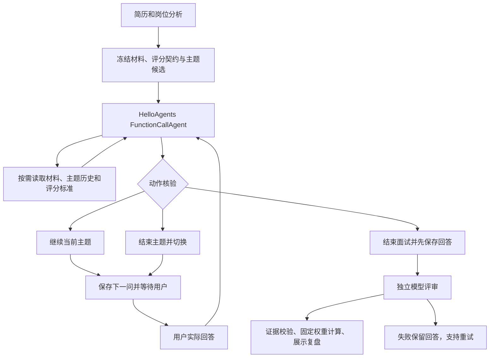

# 面试 Agent 架构与取舍

基于 React / FastAPI / SQLite 的本地单用户应用，通过连续观察回答决定追问与切换主题。

## 两层循环

外层循环跨 HTTP 请求与用户作答，状态落 SQLite；内层循环是一次请求中的原生 `model → tool → result → model`。`FunctionCallAgent` 负责原生消息协议和工具执行，业务代码负责允许动作、状态迁移与保存，不阻塞一个请求等待整场面试。

## 模块职责

| 模块                        | 职责                                                       |
| --------------------------- | ---------------------------------------------------------- |
| `config.py`                 | 模型配置校验、原子写入 `.env`、运行期配置快照              |
| `usage.py`                  | 按业务调用归集服务商返回的 Token、格式修正与截断状态       |
| `scripts/server_control.py` | 跨平台本机实例识别与正常停止                               |
| `engine.py`                 | HelloAgents 适配、结构解析、错误边界、运行事件             |
| `agent_tools.py`            | 绑定当前面试快照的只读工具、执行日志、原生工具能力探测     |
| `interview.py`              | 主题构建、动作验证、预算、结束条件、评分证据核验与加权计算 |
| `prompts.py`                | 版本化分析、面试和独立评审提示词                           |
| `rubric.py`                 | 版本化六维评分标准、权重与等级锚点                         |
| `main.py`                   | HTTP、幂等、乐观并发、后台评审与导出                       |
| `store.py`                  | SQLite 聚合、事务、revision 与日志                         |
| `agent-interview.tsx`       | 动态面试、评审轮询、证据定位、评分与改进计划               |

## Agent 的决定与程序的约束

模型根据当前回答与工具观察提出 `ask_followup`、`switch_topic` 或 `finish`，并提交简短理由。继续深挖要留在当前主题；切换只能选择未访问主题；新主题必须有成功的材料读取。模型可以因证据足够、摸清能力边界或没有新增信息而结束主题。

每次只生成下一问，不提前生成整轮题目。程序拒绝越界主题、无依据的覆盖声明、重复问题、无效材料引用和不允许的动作。整场预算默认 12 轮，单主题默认最多 6 轮；可在页面配置。总预算 2–24 轮，单主题上限 2–8 轮。达到预算不会被解释为答错，只结束本场覆盖。

内层最多两轮工具迭代，每次 Agent 请求最多执行六个已注册工具调用。网络超时由模型客户端控制；这些是步骤预算，不是整场面试的墙钟截止时间。

## 工具与信息边界

- `read_material_evidence(topic_id)`：本场冻结的简历主张与相关 JD 要求。
- `read_topic_history(topic_id)`：本场指定主题的原始问题、回答和回答 ID。
- `read_scoring_rubric()`：本场冻结的六维标准与等级锚点。

这些工具核对材料、历史和评分契约；目前不联网检索技术文档，不执行用户代码。原文存在性无法证明技术正确性或实际贡献，评审仍需人工核查。

API 只接受当前工作区的会话操作；工具接收的主题 ID 也必须属于当前会话。每次新建 Agent 并显式加载持久化状态，不共享全局 Agent 历史。日志只记录工具名、主题 ID、状态、耗时和调用元数据，不记录密钥、完整提示词或回答正文。决策日志展示简短行动理由，不输出隐含思考过程。

## 独立评审与评分

评审是独立的一次结构化模型调用，可以使用相同模型，但不接收面试官的中间判断、覆盖结论或决策记录。输入是冻结岗位与简历、实际完整问答、已作答主题和评分契约。

| 维度       | 权重 |
| ---------- | ---- |
| 技术正确性 | 25%  |
| 实现深度   | 25%  |
| 个人贡献   | 15%  |
| 取舍与边界 | 15%  |
| 验证与证据 | 15%  |
| 表达清晰度 | 5%   |

模型按 0–4 等级打分；未覆盖或证据不足用 null。非空评分、优缺点和改进计划必须关联真实回答 ID 与连续引文。不存在的引文会导致该评分改为未评估，或相关结论被隐藏，并展示警告。程序不验证模型结论是否在语义上由引文支持，这需要独立人工标注评测。

综合分只汇总有效评分：`sum(score / 4 × weight) / sum(已评估权重) × 100`。已评估权重不足 60% 时不显示综合分。前端同时展示已评估权重、维度分和引用，避免将未覆盖内容当作零分。模型输出的任意额外综合分都不作为依据。

开发者离线规则模式（`mode=demo`）不判断能力、不输出分数；其复练主题仅用于体验流程。网页中的 Agent 开发演示使用真实模型（`mode=live`、`demonstration=true`），会生成模型参考评分。模拟接口协议测试中的固定分数不属于模型质量结果。

## 持久化与失败恢复

新会话使用 `workflow_version=2`。冻结简历、JD、分析、评分契约及主题；修改当前工作区材料不会改写历史面试。旧版已完成报告继续可读，旧版进行中的面试可以结束后新建，原始问答不转换或覆盖。

面试 Agent 调用失败时不提交新回答或下一问，客户端保留草稿以便重试。最终回答先与 `awaiting_report` 状态保存，再通过后台任务评分；评分失败保留所有回答并写入可重试错误。刷新页面可读取结果，后台服务重启导致任务中断时可点击“重试评审”。后台任务不是外部持久化任务队列。

同一 request_id 相同内容重试不重复推进，冲突内容返回 409。revision 防止覆盖并发修改。每个进程同一会话的评分任务互斥；模型费用不具备跨进程 exactly-once 保证。当前产品为本地单用户，未提供多用户权限或分布式 worker。

## 演示目录与跨平台运行

仅保留 Agent 开发虚构材料，使用稳定工作区 ID 和 SQLite `INSERT OR IGNORE`。初始化清理旧内置产品/算法演示与开发演示的离线历史，个人工作区和真实模型历史保持不变。重复打开不覆盖材料或进度。

Windows `.cmd` 与 macOS/Linux `.sh` 都调用相同的 Python 入口。服务将随机控制令牌写入忽略提交的 `data/server.json`；停止命令只向本机已记录实例发请求，验证令牌与来源后通知 Uvicorn 正常退出，不通过 PID 或端口强制结束其他应用。异常退出留下的过期记录可在再次启动时回收。

## 模型配置、用量与参考答案

页面保存模型配置时验证基础地址、模型和输出预算，先原子写入本机 `.env`，成功后才更新运行期配置；密钥留空保留旧值。单次业务调用固定其配置快照，避免并发修改导致工具循环混用服务。接口不返回 API Key，校验错误不回显输入值。

使用上下文隔离归集工具循环与格式修正的所有模型响应。推理 Token 包含在服务商返回的输出量中，不重复加总；服务商缺失或不完整的 usage 保持未知，失败前已有的用量仍记录。结构失败仅自动修正一次，截断与网络错误单独提示。

独立评分通过后，每批最多四题生成学习用参考答案，校验回答 ID 覆盖；答案生成失败保留评分并支持单独重试。参考答案不参与本场打分，也不在面试中展示，避免影响候选人的原始作答。

## 真实面试自测后的可靠性修正

评审输入只保留问题文本、主题关联和回答 `turn_id`，移除问题自身 ID，避免模型把问题 ID 当作评分引用的回答 ID。无效评分引文会触发一次有上限的证据修正，重新输出完整评审；最终仍逐字验证回答 ID、主题范围和连续原文，失败项继续降级或隐藏，不直接转换或猜测 ID。

分析、评分与参考答案等长文本生成默认等待 120 秒；原生面试与连接探测保留各自短超时。关闭 OpenAI SDK 隐式重试，超时后由用户显式重试，避免将同一长生成请求反复发送。Token 截断与网络超时分别提示；无法从失败响应取得 usage 时保持未知，不推算被供应商接受或计费的用量。

## 真实模型示范与准备建议

“材料与岗位”将原文编辑与分析结果合并展示：模型逐项生成具体准备任务与可检查产物，按岗位核心职责优先级展示，原文依据与已覆盖项折叠查看；旧分析没有新增字段时保留可读并提示重新分析；不再设置独立“证据匹配”页面。

Agent 开发示范固定以 live 模式分析并创建 `demonstration=true` 面试，默认 4 轮。面试官仍使用原有只读工具与动态决策；示范候选人使用冻结材料、虚构实现设定、当前问题和本场历史生成回答；网页流式入口通过 HelloAgentsLLM 的兼容客户端输出正文，保留的同步入口使用 SimpleAgent。演示工作区所有真实面试入口默认开启模型示范，旧的未标记会话在材料快照符合案例时也可继续；个人面试禁止调用此入口，修改过演示材料也不能启动预设案例的示范。

示范草稿按 question_id 保存，重复读取复用结果；同进程并发生成返回冲突。进入每题后自动请求示范草稿，组件重复挂载共享在途请求；生成失败仅显式重试。生成成功不自动提交，用户阅读后通过普通回答接口提交，原样模型回答与编辑后回答分别标注来源。题目变化时拒绝把旧结果填入新题。故障只返回错误，不使用固定答案。单用户应用不提供多 worker 的全局生成锁，冲突后应读取已有草稿，不能承诺供应商调用 exactly-once。

独立评审仅接收实际提交问答与原有评分契约，不接收示范标签、实现设定、草稿或期望分数。复盘及导出标注模型示范，不能作为使用者本人能力结论。示范阶段用量以 demonstration_answer 运行事件计入；未返回 usage 的请求保持未知。

## 示范回答流式传输

`demonstration.py` 复用普通/流式端点的冻结材料校验与按题缓存，`streaming.py` 使用 HelloAgentsLLM 创建的兼容客户端请求原生 Chat Completions 流，设置 include_usage。框架现有流式辅助方法不处理空 choices 的用量帧，本项目读取客户端增量而不修改框架源码。同步网络读取放在线程池中，不阻塞异步 HTTP 服务。

后端以 SSE 发送 start/delta/done/error；只转发正文，不转发推理内容。正常 stop、长度校验和当前题目校验通过后才保存草稿并发出 done，截断、断流或过时题目不保存为成功回答。前端按 question_id 订阅共享在途流，重复挂载不重复生成，只有 done 后才能提交；失败显式重试，导航离开后已发起请求可完成并缓存供重入读取。

同一 provider 流中若出现多次累计 usage，以最后快照替换该次用量，而不逐帧累加；最终用量帧可为空 choices。缺失用量为未知，中断前只取得部分 usage 则标记不完整。原有普通调用记账保持不变。生成日志不保存完整提示词或密钥。
